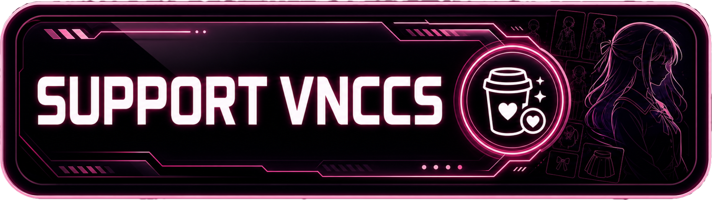
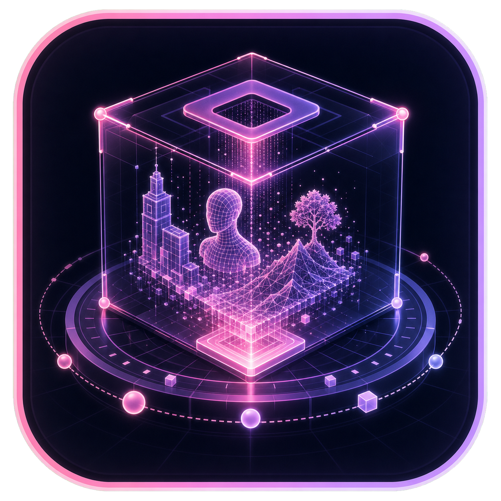
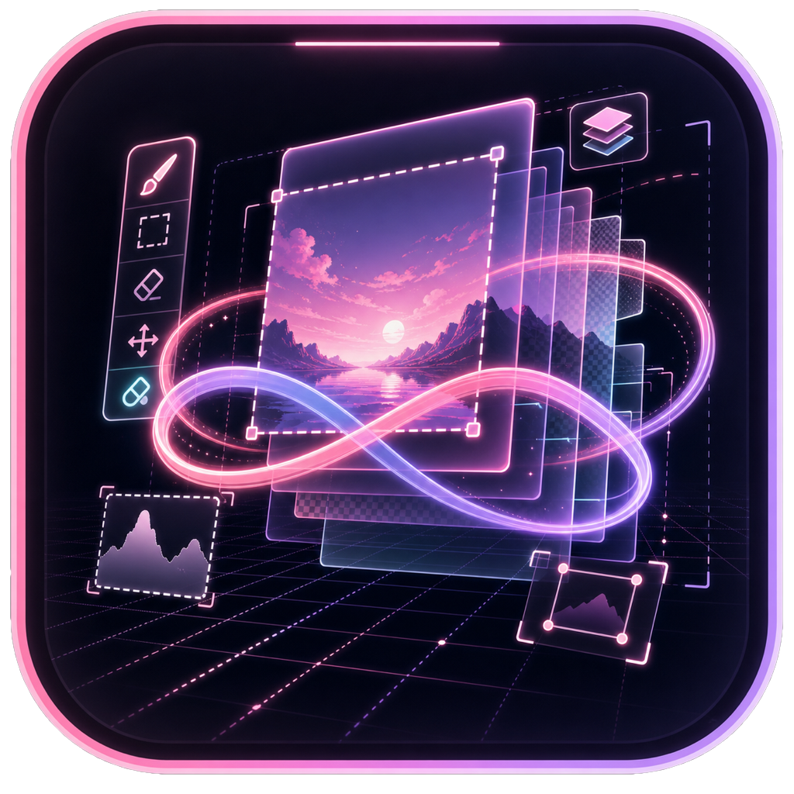
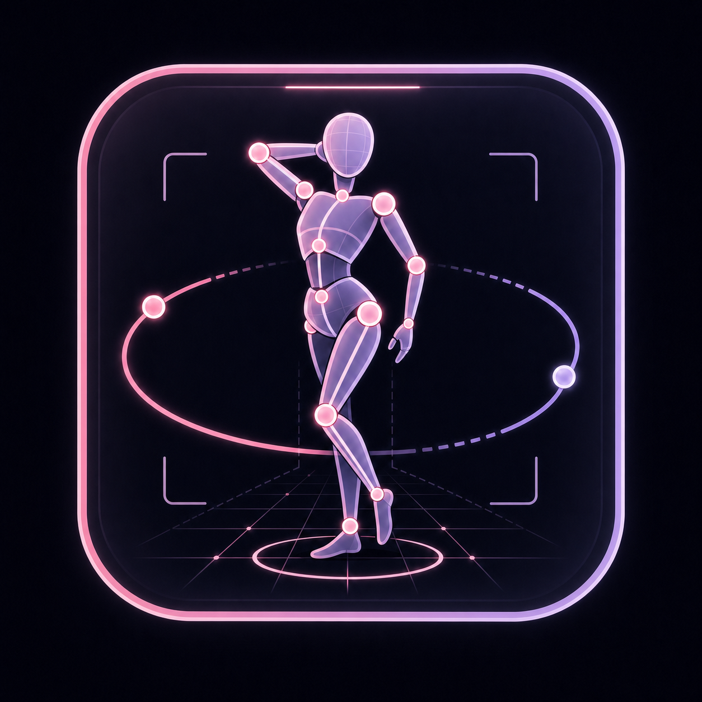

# ComfyUI VNCCS Utils

A collection of utility nodes from the [VNCCS](https://github.com/AHEKOT/ComfyUI_VNCCS) project for everyday ComfyUI workflows, including **VNCCS 3D Factory**, **VNCCS UniCanvas**, **VNCCS Pose Studio**, **VNCCS Prompt Designer**, and supporting generation utilities.

<table>
<tr>
<td width="50%" align="center">
<strong>Join The Community</strong><br>
Share results, ask questions, and follow VNCCS updates.<br><br>
<a href="https://discord.com/invite/9Dacp4wvQw" target="_blank"></a>
</td>
<td width="50%" align="center">
<strong>Support VNCCS</strong><br>
VNCCS is developed independently. Support helps keep the project moving.<br><br>
<a href="https://www.buymeacoffee.com/MIUProject" target="_blank"></a>
</td>
</tr>
</table>

---

## VNCCS 3D Factory

<p align="center">
  
</p>

**VNCCS 3D Factory** is a scene-oriented image-to-3D Gaussian workspace inside
ComfyUI. It runs the open-source
[`VAST-AI-Research/TripoSplat`](https://github.com/VAST-AI-Research/TripoSplat)
pipeline locally, turns reference images into editable 3D Gaussian models, keeps
every generated object in a persistent scene, and renders the actual Gaussian
assets through the bundled SparkJS viewport.

### Key Features

* **True Gaussian Viewport**: Multiple Gaussian PLY objects render together
  with orbit, pan, detail zoom, adaptive camera clipping, selection, and an
  optional grid—there is no synthetic floor mesh.
* **Scene Manager**: Create and reopen scenes; generated objects, names,
  transforms, generation settings, and exports persist on the ComfyUI host.
* **Gaussian PLY Import**: Add an existing validated Gaussian PLY to the active
  scene; it appears immediately in the object list and live viewport.
* **Interactive Transforms**: Click objects in the viewport and move, rotate,
  or uniformly scale them with visible viewport gizmos. Exact numeric fields
  remain available in a collapsed precision panel.
* **Saved Scene Cameras**: A graphical FPV look pad and roll control rotate the
  camera in place without changing normal viewport orbit behavior. Add up to
  32 named scene cameras, click one to inspect its exact view, and receive the
  current view followed by every saved camera as an ordered ComfyUI `IMAGE`
  LIST at the shared Scene Export resolution.
* **Local TripoSplat Pipeline**: The official pipeline runs in process with
  ComfyUI's PyTorch device. Model setup and weight download are graphical.
* **Object and Scene PLY Export**: Export every transformed object separately
  or combine the visible scene as an editable Gaussian PLY. The export bakes
  transforms into the actual Gaussian centers and covariance, preserves
  opacity and spherical-harmonic color data, and embeds the current camera plus
  every saved scene camera.
* **Gaussian Library**: Save individual objects or complete scenes with
  automatic 3D previews. `.vnccs3d` packages keep only canonical PLY assets,
  and can be saved and loaded locally. Public repository assets can be
  downloaded; publishing repositories is currently disabled.
* **Observable Jobs**: Background removal, image encoding, diffusion steps,
  Gaussian decoding, serialization, and scene insertion expose real progress,
  printed to the ComfyUI console and retained in a downloadable per-job log.
* **Persistent Widget State**: Scene selection, generation controls, source
  reference, object transforms and selection, current and saved cameras, grid,
  and transform mode are saved with the workflow. Reference images are
  persisted on the ComfyUI host rather than temporary browser file URLs.

👉 **[Setup and workflow guide](docs/VNCCS_3D_FACTORY.md)**

## VNCCS UniCanvas

<p align="center">
  
</p>

**VNCCS UniCanvas** is an integrated infinite-canvas image generation and editing workspace inside ComfyUI. It is designed for freeform creative work: generate anywhere, edit any region, build results across layers, and keep refining without being locked to a single fixed image boundary.

### Key Features

*   **Infinite Canvas Workflow**: Work beyond a single image frame and place generations wherever the composition needs them.
*   **Layer-Based Editing**: Build images from separate raster and mask layers with visibility, opacity, selection, movement, and compositing controls.
*   **Generation Anywhere**: Use a selected region as the generation target for new images, image edits, inpaint, outpaint, and full-area transformations.
*   **Mask and Object Tools**: Paint masks, refine selections, and use SAM-powered object selection to isolate or remove parts of an image.
*   **Preset and Custom Models**: Switch between built-in presets, custom checkpoints, or GGUF files for supported generation backends.
*   **Qwen Edit 2.1**: Calls ComfyUI nodes directly for generation and masked edits, including the native LoRA loader. Turbo uses the author's [ViggleTurboSigmas node](https://huggingface.co/Viggle/Qwen-Image-2.1-viggle-turbo/tree/main/comfyui).
*   **Krea2 Identity Edit**: Edit the bbox image with grounded Qwen3-VL and adjust **Likeness** in the upper-right control. See the [Krea2 Edit guide](docs/UNICANVAS_KREA2_EDIT.md).
*   **Turbo and LoRA Controls**: Use Turbo LoRA cards and a general LoRA Stack directly from the generation panel.
*   **Canvas Editing Tools**: Move, resize, rotate, snap, undo/redo, and manage generation results without leaving the node.
*   **Free Transform**: Resize, rotate, skew, distort, perspective, warp, tilt in 3D, and flip layers without rasterizing the workflow first.
*   **Crop-and-Stitch Inpaint**: Generate the selected masked area at full resolution and paste it back only inside the mask.
*   **Automatic Layer Names**: Give generated and imported layers descriptive names, with local text or vision models available for better suggestions.
*   **Live Pose Studio Layers**: Insert an editable mannequin from the vertical toolbar and pose it in a dedicated edit session, then generate characters that follow the pose with the pose and background composite as references. See the [pose layer guide](docs/UNICANVAS_POSE_LAYERS.md).
*   **360° Panorama Editing**: Import an equirectangular panorama, look around from its center, and paint, mask, transform, or generate within a square perspective view; edits stay on the sphere and exports use the complete panorama. See the [panorama guide](docs/UNICANVAS_PANORAMA.md).

### Canvas tools

*   **Brush**: paints color on the active raster layer or white mask pixels on the active mask layer. The cursor previews the selected layer's paint; it continues moving while generation blocks painting.
*   **Shape**: choose **Square**, **Circle**, or **Triangle** in Shape Settings, then drag on the active raster or mask layer. Square and Circle keep equal sides; Shift keeps the triangle's ratio, Alt draws from the center, and Ctrl/Cmd subtracts.
*   **SAM object mask**: defaults to **SAM 3**. Use **Add** for green keep points and **Subtract** for red remove points. Guidance and errors appear in the bottom SAM panel. The preview keeps its pink fill and outlines the exact mask boundary in black and white. Undo/Redo covers the preview and points; after Apply, Undo immediately restores the layer's pixels.
*   **Radial HUD**: Hold the **right mouse button** (every tool except SAM) to open a four-sector radial HUD at the cursor. Drag toward **size**, **opacity**, **hardness**, or the **foreground color**, then keep dragging to adjust that value live; release to commit. The SAM tool keeps its right-click subtract-point meaning.
*   **Brush hardness** (0-1): strokes render with soft radial-gradient edges below 1, effective immediately while painting.
*   **Settings (gear icon)**: configure the background-removal backend, automatic layer naming, inpaint behavior, performance, and diagnostic logging.
*   **Reference images**: the stacked-cards icon next to *Steps* opens a popover where up to 4 uploaded images condition the edit model; each is labelled `Picture 2`, `Picture 3`, ... so the prompt can refer to it by name (the working area is always `Picture 1`).
*   **Layer menu** (right-click a layer row): copy or save the visible layer, run background removal with an optional prompt, mark keep points with SAM, match colors to the layers below, auto-name the layer, and open pose actions for live pose layers.
*   **Background removal backends**: use an edit model, BiRefNet, rembg, or SAM 3; each path updates the layer alpha with one undoable operation.
*   **Prompt guides**: the `?` beside the prompt shows the active model family's reference syntax and source-specific guidance.
*   **Performance and diagnostics**: enable step caching for longer runs, use VAE chunking on lower-memory systems, and inspect request sizes and timings with debug mode.
*   **PSD import/export**: *Import PSD* loads raster layers (name, visibility, opacity, blend mode, stacking order); anything UniCanvas cannot represent is skipped and reported. *Export Layers as PSD* writes the layer stack as a PSD file.


### Standalone Unicanvas mode

The **Unicanvas** sidebar tab runs UniCanvas as a standalone image app — no node, no workflow. Entering it hides the ComfyUI chrome; leaving it restores everything. The engine picker offers the built-in presets plus custom models from disk; output actions replace the node's `image` socket (**Save to output** writes the flattened composite into ComfyUI's `output/` directory, **New** clears the canvas after confirmation). Work persists to `localStorage`, so it survives a page reload. Enable the tab with the `VNCCS.UniCanvas.StandaloneSidebar` ComfyUI setting.


## VNCCS Pose Studio

<p align="center">
  
</p>

**Example Workflows:** [QWEN](workflows/VNCCS_Utils%20Pose%20Studio%20QWEN.json) · [Klein9b](workflows/VNCCS_Utils%20Pose%20Studio%20Klein9b.json)

**VNCCS Pose Studio** is a professional 3D posing, framing, lighting, and pose-library environment running directly inside a ComfyUI node. It is designed for building high-quality pose/control references without leaving the graph: adjust the character body, pose bones interactively, frame the camera, tune lights, manage saved poses, and output single images or pose batches.

### Key Features

*   **Interactive 3D Viewport**: Pose the mannequin directly in the node with selectable joints, bone manipulation, transform controls, and full **Undo/Redo** support.
*   **Dynamic Body Generator**: Fine-tune the character shape with sliders for Age, Gender blending, Weight, Muscle, and Height.
*   **Multi-Pose Tabs**: Create multiple independent pose states inside one node, making batch outputs and pose sequences easier to build, with copy/paste between tabs.
*   **Keyframe Animation Mode**: Switch from static images to a dope-sheet timeline with per-bone tracks, playback, Auto-Key, draggable keys, easing presets, and deterministic frame output. Import a Mixamo FBX clip as retargeted bone keyframes.
*   **Modal Pose Gallery**: Save, browse, load, and delete poses in a focused full-screen gallery, or batch import/export pose data via JSON.
*   **Tracing Support**: Load a background reference image and align the 3D character to it for accurate pose matching.
*   **Precision Camera Controls**: Set output dimensions, zoom, model rotation, and camera orbit with an integrated radar-style control, and preview the final render boundary in the viewport.
*   **Advanced Environment Lighting**: Control Ambient, Directional, and Point Lights, including 2D radar controls for positioning point lights and radius controls for their influence. A **Keep Original Lighting** mode bypasses synthetic lighting for clean ControlNet-style outputs.
*   **Prompt Tools**: Prompt-aware lighting output, custom tag-based prompt templates (`<lighting>`, `<user_prompt>`), and a direct sidebar prompt field.
*   **Flexible Export Modes**: Output poses as a list or as a grid, with configurable background color.

👉 **[Detailed Usage Guide](docs/VNCCS_POSE_STUDIO_USAGE.md)**

## VNCCS Prompt Designer

<p align="center">
  
</p>

**VNCCS Prompt Designer** is a visual prompt-composition workspace inside a ComfyUI node. Combine freeform text, reusable block cards, dynamic variants, and conditional fragments to build prompts, preview the resolved text, and send it directly to text encoders or other nodes that accept `STRING` inputs.

### Key Features

*   **Tabbed Prompt Workspace**: Keep multiple prompt drafts in one node, mixing multiline text with draggable block cards. The active tab supplies the prompt when the workflow runs.
*   **Reusable Block Cards**: Organize prompt fragments into searchable, color-coded categories and edit their variants once for reuse across compositions.
*   **Dynamic Prompt Syntax**: Use choices, weighted and nested variants, and variables through `dynamicprompts`, while preserving your separators and line breaks.
*   **Random and Cyclic Variants**: Sample card variants randomly or cycle through them in order. Keep a fixed seed for reproducible results or randomize it for each queued generation.
*   **Conditional Fragments**: Build inline If/Else sections with equals, not equals, contains, and not contains checks, combined with AND/OR. Conditions can use the resolved value of a block card.
*   **Multiple Prompt Outputs**: Create multi-prompt fragments that produce up to 16 separate `STRING` outputs from one composition, with sockets exposed as needed.
*   **Resolved Prompt Preview**: Inspect the sampled prompt and block variants with the same seeded sampling used during execution, before queueing a workflow.
*   **Persistent Prompt Library**: Save reusable blocks and complete prompt templates on the ComfyUI host, with automatic draft saving, revision history, and recovery. Bundled starter cards cover backgrounds, colors, clothing, hairstyles, and Anima styles.
*   **Undo/Redo and Workflow Persistence**: Undo composition edits and keep tabs, blocks, conditions, seeds, and settings with the saved workflow.

Add **VNCCS Prompt Designer** from the `VNCCS/prompt` category and connect its `prompt` output to a text encoder. Multi-prompt compositions also expose `prompt2`, `prompt3`, and further outputs for separate workflow branches.

## Additional Nodes

### VNCCS Visual Camera Control
**[Example Workflow](workflows/VNCCS_Utils%20Visual%20camera%20control%20node%20for%20Qwen-Image-Edit-2511-Multiple-Angles%20LoRa.json)**

An interactive node with a visual widget for controlling camera position. It is designed for intuitive angle control and prompt generation, especially for multi-angle LoRAs like **Qwen-Image-Edit-2511-Multiple-Angles**.

*   **Visual Widget**: Select azimuth and distance with the mouse.
*   **Elevation Slider**: Pick elevation from -30° to 60°.
*   **Trigger Word Toggle**: Enable or disable the `<sks>` trigger from the widget.
*   **Random Range Toggle**: Randomize across the full 360° or restrict random views to the front ±45° while keeping elevation and distance random.

### VNCCS BBox Extractor

A helper node for extracting and visualizing crops when you need detected bounding-box regions without running a full face/detailer workflow.

## Installation

### Recommended: ComfyUI Manager

1. Open **ComfyUI Manager**.
2. Choose **Custom Nodes Manager**.
3. Search for **VNCCS Utils**.
4. Click **Install**.
5. Restart ComfyUI.

### Manual Installation

Open a terminal in your ComfyUI directory and run:

```bash
cd ComfyUI/custom_nodes
git clone https://github.com/AHEKOT/ComfyUI_VNCCS_Utils.git
cd ComfyUI_VNCCS_Utils
pip install -r requirements.txt
```

Open **Model setup** inside VNCCS 3D Factory to detect or download the official
TripoSplat weights in the standard `ComfyUI/models/{diffusion_models,vae,clip_vision,background_removal}`
folders. ComfyUI `extra_model_paths` are also searched. The inference pipeline
runs directly in ComfyUI and does not require a separate server.

Restart ComfyUI after installation.

## Star History

<a href="https://www.star-history.com/?repos=AHEKOT%2FComfyUI_VNCCS_Utils%2CAHEKOT%2FComfyUI_VNCCS%2CAHEKOT%2FComfyUI_HYWorld2&type=timeline&legend=top-left">
 <picture>
   <source media="(prefers-color-scheme: dark)" srcset="https://api.star-history.com/chart?repos=AHEKOT%2FComfyUI_VNCCS_Utils%2CAHEKOT%2FComfyUI_VNCCS%2CAHEKOT%2FComfyUI_HYWorld2&type=timeline&theme=dark&legend=top-left" />
   <source media="(prefers-color-scheme: light)" srcset="https://api.star-history.com/chart?repos=AHEKOT%2FComfyUI_VNCCS_Utils%2CAHEKOT%2FComfyUI_VNCCS%2CAHEKOT%2FComfyUI_HYWorld2&type=timeline&legend=top-left" />
   
 </picture>
</a>
